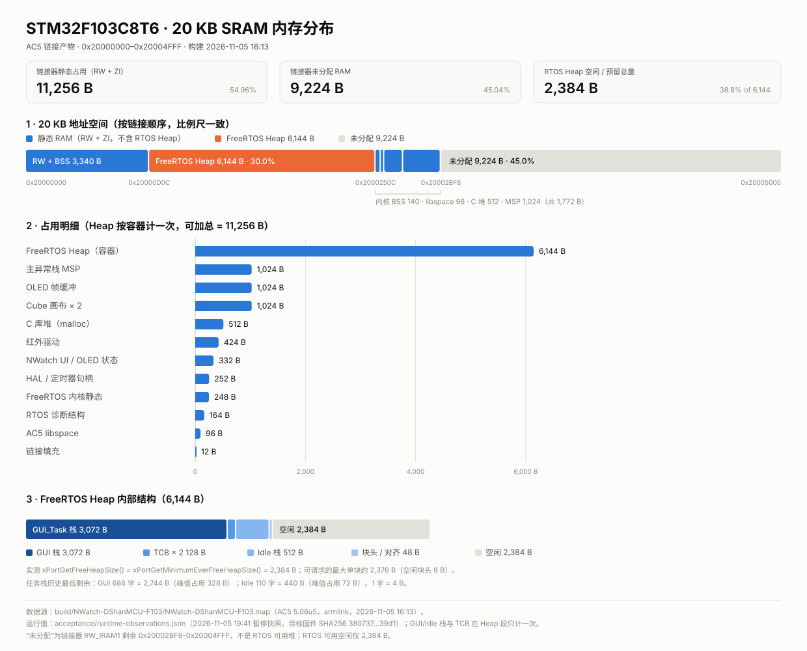

# NWatch-DShanMCU-F103-RTOS · 20 KB RAM 内存分析报告

- 分析对象：`MDK-ARM/build/NWatch-DShanMCU-F103/NWatch-DShanMCU-F103.{map,axf,htm}`
- 目标器件：STM32F103C8T6，20,480 B SRAM / 65,536 B Flash
- 工具链：ARM Compiler 5.06 update 5 (build 528)，armlink；VSCode + EIDE
- 分析日期：2026-11-07
- 本轮只读分析：未修改源码、未修改编译/链接配置、未重建、未烧录



PNG 预览：[ram_20kb_distribution.png](ram_20kb_distribution.png)

---

## 0. 结论摘要

| 指标 | 数值 | 说明 |
|---|---:|---|
| 链接器静态 RAM（RW + ZI） | **11,256 B** | 20,480 B 的 **54.96%** |
| 链接器未分配 RAM | **9,224 B** | 20,480 B 的 **45.04%** |
| FreeRTOS Heap 预留 | **6,144 B** | 已包含在 11,256 B 内，不可再加 |
| Heap 内已分配 | **3,744 B** | 2 个栈 + 2 个 TCB + 4 个块头 |
| Heap 内空闲 | **2,384 B** | 实测 `xPortGetFreeHeapSize()` 与历史最小值一致 |
| GUI_Task 栈 | 3,072 B 分配 / 峰值占用 **328 B** | 历史最低剩余 686 字（2,744 B） |
| Idle_Task 栈 | 512 B 分配 / 峰值占用 **72 B** | 历史最低剩余 110 字（440 B） |
| OLED + UI 实际占用 | **2,380 B** | 帧缓冲 1,024 + Cube 画布 1,024 + 其他 332 |
| HAL / 定时器句柄 | **252 B** | 纯 ST HAL 自有仅 100 B |
| 可安全回收的静态 RAM | **约 832 B（三项核心）～1,184 B（含 MSP 与诊断裁剪）** | 见第 10 节 |
| 新增 Input_Task + Queue | **约 688 B（128 字栈）～1,200 B（256 字栈）** | 从现有 Heap 空闲出，不增加静态总量 |

结论：当前 RAM 余量充足，没有“快满了”的风险。真正的大头是 **FreeRTOS Heap 6,144 B（占静态 54.6%）** 和 **两块各 512 B 的 Cube 画布**；GUI 栈配置 3,072 B 但历史峰值只用了 328 B。由于本轮禁止改 `configTOTAL_HEAP_SIZE` 与任务栈，最大的可落地静态收益来自合并 Cube 画布与缩小 C 库堆。

---

## 1. 数据来源与有效性

| 证据 | 时间 | 用途 | 有效性 |
|---|---|---|---|
| `build/NWatch-DShanMCU-F103/NWatch-DShanMCU-F103.map`（393,383 B） | 2026-11-05 16:13:17 | 全部静态符号、地址、段大小 | 当前源码未再变化（见下） |
| `NWatch-DShanMCU-F103.axf`（860,980 B） | 2026-11-05 16:13:17 | 符号与镜像 | 与 MAP 同批产物 |
| `NWatch-DShanMCU-F103.htm`（183,317 B） | 2026-11-05 16:13:17 | 链接器调用图/静态栈分析 | `Maximum Stack Usage = 280 B + Unknown` |
| `acceptance/runtime-observations.json` | 2026-11-05 19:41:43 | 栈水位、Heap 余量、任务数 | 硬件暂停快照，3 次采样 |
| `acceptance/REPORT.md` / `final-verification.json` | 2026-11-05 19:44:46 | 验收结论、TCB 地址、最低水位 | 与上述固件同批 |
| `acceptance/verification.json` | 2026-11-05 | `tcb_bytes = 64` | 静态核对 |

有效性说明：

1. 工程内所有业务源码、头文件和启动文件的最后修改时间都早于 MAP 的 2026-11-05 16:13:17；没有“源码比镜像新”的迹象（EIDE 生成的 `.sct` 元数据见第 5 条）。
2. 运行数据是 **2026-11-05 的硬件快照**，不是本轮重新读取。验收结束时 ST-Link 已不再枚举，因此本轮没有伪造新的实时值；下文所有运行值均注明来源。
3. 运行采样的固件就是本 MAP 对应的镜像（验收记录中的装载字节数 35,676 B 与当前 MAP 一致）。
4. 栈水位的覆盖范围限于当次实际跑过的路径（表盘、菜单/立方体、动画、红外）。它不能证明未覆盖路径或无限期运行安全，第 10 节的栈缩减建议必须重新实测。
5. EIDE 在 2026-11-07 14:36 刷新了 `builder.params`、`compile_commands.json`、`.sct` 等工程元数据，但没有触发重新编译；当前 `.sct` 的 `LR_IROM1 0x00010000`、`RW_IRAM1 0x00005000` 与 MAP 完全一致，因此本报告仍以 2026-11-05 的 MAP/AXF 为准。

---

## 2. 静态 RAM 总览

MAP 尾部：

```text
Total RW  Size (RW Data + ZI Data)   11256 (10.99kB)
Total ROM Size (Code + RO + RW)      35676 (34.84kB)
```

- RW-data：**356 B**（`0x20000000–0x20000164`，其中对象数据 344 B + 段间对齐填充 12 B）
- ZI-data：**10,900 B**（`0x20000164–0x20002BF8`）
- 合计：**11,256 B**，链接区域 `RW_IRAM1` 大小 `0x2BF8`，上限 `0x5000`。

按用途分组（互不重复，可加总到 11,256 B）：

| 分组 | 字节 | 占静态 | 占 20 KB | 内容 |
|---|---:|---:|---:|---|
| FreeRTOS Heap 预留 | 6,144 | 54.6% | 30.0% | `ucHeap` 整体，含 GUI/Idle 栈与 TCB |
| 主异常栈 MSP | 1,024 | 9.1% | 5.0% | `Stack_Mem`，ISR 与调度前主栈 |
| OLED 帧缓冲 | 1,024 | 9.1% | 5.0% | `oledBuffer`，128×64×1bpp |
| Cube 画布 ×2 | 1,024 | 9.1% | 5.0% | `OLED_GRAM` + `__OLED_GRAM`，各 64×64×1bpp |
| C 库堆 | 512 | 4.5% | 2.5% | `Heap_Mem`，`draw_string_P` 的 `malloc` |
| 红外驱动 | 424 | 3.8% | 2.1% | 68 个时间戳 + 128 B 键值环 + 状态 |
| NWatch UI 状态 | 332 | 2.9% | 1.6% | 显示/菜单/按钮/时间/表盘等 |
| HAL / 定时器句柄 | 252 | 2.2% | 1.2% | `hi2c1`、TIM 句柄、HAL tick |
| FreeRTOS 内核静态 | 248 | 2.2% | 1.2% | 就绪/延时链表、TCB 指针、port 变量 |
| RTOS 诊断结构 | 164 | 1.5% | 0.8% | `g_nwatchRtos` 96 + `g_nwatchFault` 68 |
| AC5 libspace | 96 | 0.9% | 0.5% | C 库可重入工作区 |
| 链接填充 | 12 | 0.1% | 0.1% | 4 处 PAD |
| **合计** | **11,256** | **100%** | **54.96%** | |

---

## 3. 全部主要 RAM 对象（按大小降序）

“类型”列：**静态** = 链接器直接分配；**堆内** = 运行时由 `pvPortMalloc` 从 `ucHeap` 分配；**C 库** = AC5 独立堆。地址来自 MAP；堆内对象地址是按 heap_4 布局推导，并与验收记录中实测的 TCB 地址（`0x20001920` / `0x20001B70`）一致。

| # | 对象 | 所属文件 | 字节 | 地址范围 | 类型 | 用途 |
|---:|---|---|---:|---|---|---|
| 1 | `ucHeap` | `heap_4.c` | 6,144 | `0x20000D0C–0x2000250C` | 静态 | FreeRTOS 全部动态内存的容器 |
| 2 | GUI_Task 栈 | `main.c` / `rtos_app.c`（`NWATCH_GUI_STACK_WORDS=768`） | 3,072 | `0x20000D18–0x20001918` | 堆内 | GUI 任务栈（768 字 × 4 B） |
| 3 | `Stack_Mem`（MSP） | `startup_stm32f103xb.s` | 1,024 | `0x200027F8–0x20002BF8` | 静态 | 主异常栈 / ISR / 调度前 |
| 4 | `oledBuffer` | `driver_oled.c` | 1,024 | `0x20000348–0x20000748` | 静态 | OLED 显示帧缓冲 |
| 5 | `OLED_GRAM` | `tunemaker.c` | 512 | `0x20000850–0x20000A50` | 静态 | Cube 页 64×64 画布 |
| 6 | `__OLED_GRAM` | `watchface.c` | 512 | `0x20000A68–0x20000C68` | 静态 | 第二个 Cube 页 64×64 画布 |
| 7 | `Heap_Mem` | `startup_stm32f103xb.s` | 512 | `0x200025F8–0x200027F8` | 静态 | AC5 C 库堆（`malloc/free`） |
| 8 | Idle_Task 栈 | FreeRTOS `xTaskCreate`（`configMINIMAL_STACK_SIZE=128`） | 512 | `0x20001968–0x20001B68` | 堆内 | 空闲任务栈（128 字 × 4 B） |
| 9 | `g_IRReceiverIRQ_Timers[68]` | `driver_ir_receiver.c` | 272 | `0x20000238–0x20000348` | 静态 | NEC 红外 68 个时间戳（16 位采样） |
| 10 | `g_KeysBuf[128]` | `driver_ir_receiver.c` | 128 | `0x200001B8–0x20000238` | 静态 | 红外按键环形缓冲 |
| 11 | `__libspace_start` | `libspace.o`（AC5） | 96 | `0x20002598–0x200025F8` | 静态 | C 库可重入工作区 |
| 12 | `g_nwatchRtos` | `RTOS/rtos_app.c` | 96 | `0x20000C68–0x20000CC8` | 静态 | RTOS 运行诊断（24 个 32 位字段） |
| 13 | `hi2c1` | `Core/Src/main.c` | 84 | `0x20000164–0x200001B8` | 静态 | HAL I2C1 句柄 |
| 14 | `pxReadyTasksLists[4]` | `tasks.c` | 80 | `0x2000250C–0x2000255C` | 静态 | 4 级就绪链表 |
| 15 | `tickTimer` | `driver_systick.c` | 72 | `0x20000748–0x20000790` | 静态 | TIM4 HAL 句柄（HAL 毫秒时基） |
| 16 | `microTimer` | `driver_timer.c` | 72 | `0x20000790–0x200007D8` | 静态 | TIM3 HAL 句柄（微秒时基） |
| 17 | `g_nwatchFault` | `RTOS/rtos_app.c` | 68 | `0x20000CC8–0x20000D0C` | 静态 | 故障现场（17 个 32 位字段） |
| 18 | GUI TCB | FreeRTOS `tasks.c` | 64 | `0x20001920–0x20001960` | 堆内 | GUI 任务控制块 |
| 19 | Idle TCB | FreeRTOS `tasks.c` | 64 | `0x20001B70–0x20001BB0` | 堆内 | 空闲任务控制块 |
| 20 | `xDelayedTaskList1/2`、`xPendingReadyList` | `tasks.c` | 60 | `0x2000255C–0x20002598` | 静态 | 延时/待就绪链表 |
| 21 | `buttons` | `buttons.c` | 48 | `0x200007E4–0x20000814` | 静态 | 按键状态（`buttonData_t` 数组） |
| 22 | `menuData` | `menu.c` | 36 | `0x20000814–0x20000838` | 静态 | 菜单当前项/动画状态 |
| 23 | `vert[8][3]` | `tunemaker.c` | 24 | `0x20000838–0x20000850` | 静态 | 当前帧立方体顶点 |
| 24 | `vert1[8][3]` | `watchface.c` | 24 | `0x20000A50–0x20000A68` | 静态 | 第二个 Cube 页顶点 |

补充：`.data` 区共 356 B（对象数据 344 B + 12 B 对齐填充），按对象较大的有 `display.o` 34 B、`watchface.o` 29 B、`heap_4.o` 28 B、`driver_ir_receiver.o` 24 B、`draw.o` 16 B、`m_main.o` 16 B、`time.o` 16 B、`tunemaker.o` 16 B、`normal.o` 13 B、`port.o` 12 B、`stm32f1xx_hal.o` 12 B；其余为每文件 4～8 B 的状态变量。它们不是“死数据”，多数是初始化一次的运行状态。

---

## 4. 最占 RAM 的前 15 个对象

> 第 1 名 `ucHeap` 是容器，第 2 名 GUI 栈、第 8 名 Idle 栈以及未进前 15 的两个 TCB（各 64 B）都在它内部；本表按“容器 + 内部对象”展示，因此 **不能纵向相加**。可加总的视图见第 9 节与分布图第 2 栏。

| 排名 | 对象/变量 | 所属文件 | RAM 占用(B) | 用途 | 能否优化 |
|---:|---|---|---:|---|---|
| 1 | `ucHeap` | `heap_4.c` | 6,144 | FreeRTOS 动态内存容器 | 否（本轮硬约束；且不宜现在缩） |
| 2 | GUI_Task 栈 | `main.c` / `rtos_app.c` | 3,072 | GUI 主循环 | 可增大 Heap 余量，不减少静态 RAM |
| 3 | `Stack_Mem` (MSP) | `startup_stm32f103xb.s` | 1,024 | 异常/中断栈 | 可谨慎缩到 768（−256） |
| 4 | `oledBuffer` | `driver_oled.c` | 1,024 | OLED 帧缓冲 | 否（UI 核心） |
| 5 | `OLED_GRAM` | `tunemaker.c` | 512 | Cube 画布 A | 可与 B 合并（合计 −512） |
| 6 | `__OLED_GRAM` | `watchface.c` | 512 | Cube 画布 B | 可与 A 合并（合计 −512） |
| 7 | `Heap_Mem` | `startup_stm32f103xb.s` | 512 | C 库 malloc 堆 | 可缩到 256（−256） |
| 8 | Idle_Task 栈 | FreeRTOS Idle | 512 | 空闲任务 | 可缩，仅增加 Heap 余量 |
| 9 | `g_IRReceiverIRQ_Timers` | `driver_ir_receiver.c` | 272 | 红外时间戳 | 否（68 项已是 NEC 帧下限） |
| 10 | `g_KeysBuf` | `driver_ir_receiver.c` | 128 | 红外键值环 | 可缩到 64（−64） |
| 11 | `__libspace_start` | `libspace.o` | 96 | AC5 库工作区 | 否 |
| 12 | `g_nwatchRtos` | `rtos_app.c` | 96 | 运行诊断 | 可裁剪（−32～96，会丢调试信息） |
| 13 | `hi2c1` | `main.c` | 84 | HAL I2C 句柄 | 否 |
| 14 | `pxReadyTasksLists[4]` | `tasks.c` | 80 | 4 级就绪链表 | 否 |
| 15 | `tickTimer` / `microTimer`（并列） | `driver_systick.c` / `driver_timer.c` | 72 + 72 | TIM4 / TIM3 句柄 | 否 |

紧随其后：`g_nwatchFault` 68 B、两个 TCB 各 64 B、`xDelayedTaskList1/2` 等 60 B、`buttons` 48 B、`menuData` 36 B、两组顶点各 24 B。

### 逐个可优化对象的说明

**A. `OLED_GRAM` + `__OLED_GRAM`（各 512 B）**

- 为什么需要：`tunemaker.c` 与 `watchface.c` 各自维护一块 64×64×1bpp 画布，画完用 `draw_bitmap(0,0,...,64,64)` 贴到主帧缓冲，然后 `memset`。
- 能否 `const`：不能，它们是每次动画重绘的可写画布。
- 能否缩小：不能，64×64 是当前立方体的绘制范围。
- 能否消除重复：**能**。两个页面不可能同时绘制（`display_setDrawFunc()` 一次只装一个 `draw`），可合并为一个 512 B 共享画布，合计 **−512 B**。
- 更激进：直接画到 `oledBuffer` 的左上 64×64 区域，可 **−1,024 B**，但要处理贴图偏移和清屏范围，风险更高，不建议第一步做。
- 影响：Cube 页与表盘切换时的首帧；需在切页时清空共享画布，避免残影。

**B. C 库堆 `Heap_Mem`（512 B）**

- 为什么需要：`draw.c` 的 `draw_string_P()` 用 VLA 风格的 `char buff[len+1]`，AC5 实际调用 `malloc/free`（MAP 交叉引用与反汇编均证实：`0x08003E74 BL malloc`，`0x08003E92 B free`）。
- 实际最大请求：只与 UI 字符串长度有关，当前最长约 15～20 B；512 B 远大于需求。
- 能否缩小：能，**512 → 256 B** 可省 256 B。AC5 每个块有管理开销，256 B 仍留有 8 倍以上余量。
- 能否消除：不能，除非改写 `draw_string_P` 为固定小缓冲（会改业务源码，本轮不做）。
- 影响：`draw_string_P` 的 `malloc` 失败路径；缩到 256 B 风险低，缩到 128 B 仍大概率可用但不建议。

**C. `g_KeysBuf[128]`（128 B）**

- 为什么需要：红外 ISR 解析出的 device/data 两个字节成对入环，GUI 每轮读取。
- 能否缩小：能，**128 → 64 B**（32 个按键事件）可省 64 B。GUI 每轮至少一次 `buttons_update`，I2C 最坏阻塞时 64 B 仍不易溢出。
- 影响：极端连发/长时间阻塞时的丢键概率；建议保留 64，不建议低于 32。

**D. 主异常栈 MSP（1,024 B）**

- 为什么需要：调度前 `main()`、所有 ISR、HardFault 捕获路径使用 MSP；任务使用 PSP。
- 能否缩小：链接器静态分析为 `280 B + Unknown`（函数指针路径未知）。768 B 仍有约 2.7 倍余量，可省 256 B。
- 影响：EXTI 红外回调、TIM3/TIM4 ISR、HardFault 现场保存。属于“可做但需实测”的项，保守方案是保持 1,024。

**E. `g_nwatchRtos` / `g_nwatchFault`（96 + 68 B）**

- 为什么需要：为 ST-Link 观察调度器状态、栈水位、Heap、故障现场而设计。
- 能否缩小：能，但会降低可诊断性。验收已通过，可裁到最小字段集，约省 32～96 B。
- 影响：后续调试与故障定位；不建议在新增任务前删除。

**F. GUI_Task 栈（堆内 3,072 B）**

- 为什么需要：768 字是为初始化、表盘、菜单、立方体、`sprintf`、HAL I2C 预留的保守值。
- 实测峰值：仅 82 字（328 B），剩余 686 字（2,744 B）。
- 能否缩小：能，**768 → 512 字** 可释放 1,024 B Heap 余量，仍有 430 字余量；**但不减少 11,256 B 静态 RAM**（Heap 总量不变）。
- 影响：深层路径（菜单动画 + `sprintf` + I2C 错误路径）未全部覆盖；缩栈后必须重新跑水位验收。

**G. Idle_Task 栈（堆内 512 B）**

- 实测峰值 18 字（72 B），128 → 96 字可释放 128 B Heap 余量；收益小，优先级低。

**H. 只读化 / 去重**

- `.data` 356 B 中大部分是可变状态，真正能 `const` 的很少；`display.o` 与 `draw.o` 各存一份 `g_xres/g_yres/g_bpp/g_framebuffer`（各 16 B），`tunemaker.c` 与 `watchface.c` 也各存一份角度/顶点状态（各约 40 B）。去重合计约 **40～60 B**，收益低、改动面广，不建议优先做。

---

## 5. FreeRTOS 内存分析

### 5.1 静态 vs 动态

| 类别 | 内容 | 分配时机 |
|---|---|---|
| 静态 | `ucHeap[6144]`（ZI） | 链接时 |
| 静态 | `tasks.c` 就绪/延时链表、`pxCurrentTCB`、tick 变量（200 B） | 链接时 |
| 静态 | `port.c` 的 `ucMaxSysCallPriority` 等（12 B） | 链接时 |
| 静态 | `heap_4.c` 的 `pxEnd`、剩余量、分配计数（28 B） | 链接时 |
| 动态 | GUI 栈 3,072 + TCB 64 | `xTaskCreate()` 时从 `ucHeap` 分配 |
| 动态 | Idle 栈 512 + TCB 64 | `vTaskStartScheduler()` 创建 Idle 时分配 |
| 动态 | 队列/信号量/定时器 | **当前没有**（`configUSE_TIMERS=0`，无 queue/semaphore 创建） |

`configSUPPORT_STATIC_ALLOCATION = 0`，因此任务只能动态创建；不存在“静态任务 + 动态任务”两套栈。

### 5.2 Heap 内部逐字节布局

`ucHeap` 起始 `0x20000D0C`，8 字节对齐后从 `0x20000D10` 开始。实测/推导：

| 地址 | 大小(B) | 内容 |
|---|---:|---|
| `0x20000D0C–0x20000D10` | 4 | 起始对齐填充（heap_4 不使用） |
| `0x20000D10–0x20000D18` | 8 | GUI 栈块头 |
| `0x20000D18–0x20001918` | 3,072 | **GUI_Task 栈** |
| `0x20001918–0x20001920` | 8 | GUI TCB 块头 |
| `0x20001920–0x20001960` | 64 | **GUI TCB**（实测地址一致） |
| `0x20001960–0x20001968` | 8 | Idle 栈块头 |
| `0x20001968–0x20001B68` | 512 | **Idle_Task 栈** |
| `0x20001B68–0x20001B70` | 8 | Idle TCB 块头 |
| `0x20001B70–0x20001BB0` | 64 | **Idle TCB**（实测地址一致） |
| `0x20001BB0–0x20002500` | 2,384 | **空闲块**（含 8 B 空闲块头） |
| `0x20002500–0x20002508` | 8 | `pxEnd` 尾哨兵 |
| `0x20002508–0x2000250C` | 4 | 尾部对齐填充 |

### 5.3 账目核对

```text
6,144 B (ucHeap)
= 16 B  堆结构/对齐（4 起始 + 8 尾哨兵 + 4 尾对齐）
+ 32 B  4 个已分配块头（8 B × 4）
+ 3,584 B 两个栈（3,072 + 512）
+ 128 B 两个 TCB（64 × 2）
+ 2,384 B 空闲
```

- `xPortGetFreeHeapSize()` 实测：**2,384 B**
- `xPortGetMinimumEverFreeHeapSize()` 实测：**2,384 B**
- 注意：2,384 B 是“空闲块总大小（含它自己的 8 B 块头）”，因此**单次最大可请求约 2,376 B**。
- Heap 管理开销合计 **48 B**（16 B 结构 + 32 B 块头）；另有 `heap_4.c` 的 28 B 全局变量在 Heap 之外。

### 5.4 内核其他对象

- `configUSE_TIMERS = 0`：没有 Timer 任务、Timer 队列、Timer 命令队列——这是省 RAM 最多的配置项之一。
- `configUSE_TASK_NOTIFICATIONS = 0`：TCB 保持 64 B，没有通知数组。
- `configUSE_MUTEXES / COUNTING_SEMAPHORES = 0`：没有信号量对象。
- `configQUEUE_REGISTRY_SIZE = 0`：无队列注册表。
- `queue.c` 已链接但当前未创建任何队列；`list.c` 无静态 RAM。
- `configMAX_TASK_NAME_LEN = 12`：两个 TCB 各 12 B 名字；缩到 8 只省 8 B，收益可忽略。
- `configCHECK_FOR_STACK_OVERFLOW = 2`：不额外占 RAM。

---

## 6. 运行时任务栈（历史硬件数据）

数据来源：`acceptance/runtime-observations.json`（2026-11-05 19:41，3 次暂停快照）与 `acceptance/REPORT.md`（最低观测值）。单位换算：**1 字 = 4 B**。

| 任务 | 配置栈 | 分配字节 | 历史最低剩余（字） | 最低剩余（B） | 峰值占用（字/B） | 峰值占比 |
|---|---:|---:|---:|---:|---:|---:|
| GUI_Task | 768 字 | 3,072 | **686** | **2,744** | 82 / **328** | 10.7% |
| Idle_Task | 128 字 | 512 | **110** | **440** | 18 / **72** | 14.1% |

说明：

- `uxTaskGetStackHighWaterMark()` 的返回值单位是 **`StackType_t` 个字（Cortex-M3 上 1 字 = 4 B）**，源码 `prvTaskCheckFreeStackSpace()` 先数填充字节 `0xA5`，再除以 `sizeof(StackType_t)`。不能把 686 当成字节。
- 686 字是“历史最少未使用栈”，不是当前 PSP 到栈底的距离；它只能证明本次覆盖路径下的最差情况。
- `runtime-observations.json` 三次快照的 GUI 水位为 688/688/688 字，Idle 为 118/110/110 字；`REPORT.md` 另记录了受控复位前后的最低值 686 字。本报告取更差的 686 / 110。
- 任务数实测 2（GUI + Idle），调度器状态 2（RUNNING），无栈溢出/断言/malloc 失败记录。

---

## 7. OLED / NWatch UI 实际 RAM

| 项目 | 字节 | 说明 |
|---|---:|---|
| `oledBuffer` | 1,024 | 128×64÷8 = 1,024，主帧缓冲 |
| `driver_oled` 状态 | 8 | `mem_mode` 1 + `g_pHI2COLED` 4 + 填充 |
| `OLED_GRAM`（tunemaker） | 512 | 64×64÷8 = 512 |
| `__OLED_GRAM`（watchface） | 512 | 64×64÷8 = 512 |
| NWatch UI 其他状态 | 324 | 见下 |
| **合计** | **2,380** | 占 20 KB 的 11.6% |

“其他 324 B”构成：`animation` 12、`appconfig` 8、`buttons` 56、`display` 34、`draw` 16、`m_display` 8、`m_main` 16、`menu` 44、`normal` 13、`pwrmgr` 8、`time` 16、`tunemaker` 非画布部分 40（`.data` 16 + 顶点 24）、`watchface` 非画布部分 53（`.data` 29 + 顶点 24）。合计 324。

---

## 8. HAL 驱动实际 RAM

| 项目 | 字节 | 文件 | 说明 |
|---|---:|---|---|
| `hi2c1` | 84 | `main.c` | `I2C_HandleTypeDef` |
| HAL tick 变量 | 12 | `stm32f1xx_hal.c` | `uwTick` 4 + `uwTickPrio` 4 + `uwTickFreq` 1 + 填充 3 |
| `SystemCoreClock` | 4 | `system_stm32f1xx.c` | 72 MHz |
| TIM4 句柄 `tickTimer` | 72 | `driver_systick.c` | `TIM_HandleTypeDef` |
| TIM3 句柄 `microTimer` | 72 | `driver_timer.c` | `TIM_HandleTypeDef` |
| 微秒溢出计数 | 8 | `driver_timer.c` | `uint64_t microOverflowUs` |
| **合计** | **252** | | 其中纯 ST HAL 自有仅 **100 B**（84 + 12 + 4） |

GPIO/I2C/TIM 的外设寄存器不在 SRAM 中；HAL 的 GPIO、I2C、RCC、FLASH 等模块本身没有静态 RAM 全局（组件表中 RW/ZI 为 0），RAM 主要花在**句柄结构**上。

---

## 9. 20 KB RAM 分布（A–F，数字不重复累加）

| 记号 | 含义 | 数值 | 与其它项的关系 |
|---|---|---:|---|
| **A** | 链接器静态 RAM（RW + ZI） | **11,256 B** | 已包含 B、MSP、C 堆、OLED、UI 等全部静态项 |
| **B** | FreeRTOS Heap 预留容量 | **6,144 B** | 是 A 的子集，不能加到 A 上 |
| **C** | Heap 内部已分配 | **3,744 B**（含 32 B 块头；纯载荷 3,712 B） | B = C + D + 16 B |
| **D** | Heap 内部剩余 | **2,384 B**（可请求上限约 2,376 B） | B = C + D + 16 B |
| **E** | 链接器未分配 RAM | **9,224 B** | 20,480 − A；不含 Heap 空闲 |
| **F** | 任务栈历史最低剩余 | GUI **2,744 B** / Idle **440 B** | 是 C 内部的“未用部分”，不是额外内存 |

恒等式：

```text
A = 11,256 B
20,480 = A + E = 11,256 + 9,224
B = 6,144 = C(3,744) + D(2,384) + 16(结构/对齐)
C = 3,584(栈) + 128(TCB) + 32(块头)
F(GUI) = 3,072 − 328 = 2,744 B
F(Idle) = 512 − 72 = 440 B
```

常见误算：

- ❌ 11,256 + 6,144 + 3,072 + 512 = 20,984 B —— 把 Heap、GUI/Idle 栈重复加了。
- ❌ 9,224 B 当作“RTOS 还能分配 9 KB” —— 错；RTOS 只能从 Heap 的 **2,384 B** 里分配。
- ❌ 686 字当作 686 B —— 错；是 2,744 B。

地址顺序（与分布图第 1 栏一致）：

```text
0x20000000  .data + 驱动/UI/内核 BSS          3,340 B
0x20000D0C  FreeRTOS ucHeap                   6,144 B
0x2000250C  tasks.o BSS                         140 B
0x20002598  libspace                             96 B
0x200025F8  C 库 Heap_Mem                        512 B
0x200027F8  MSP Stack_Mem                      1,024 B
0x20002BF8  未分配                             9,224 B
0x20005000  SRAM 结束
```

---

## 10. 优化建议（按优先级与风险）

### 第一级：数据布局，不影响 UI / 调度（建议优先）

| 建议 | 节省 | 做法 | 风险 | 影响 |
|---|---:|---|---|---|
| 合并两块 Cube 画布 | **−512 B** | 把 `tunemaker.c` 的 `OLED_GRAM` 与 `watchface.c` 的 `__OLED_GRAM` 合并为一个共享 512 B 画布（或 `extern` 同一数组） | 低 | Cube 页/表盘切换首帧；切页时清空 |
| C 库堆 512 → 256 | **−256 B** | 修改 `startup_stm32f103xb.s` 的 `Heap_Size` | 低 | `draw_string_P` 的临时字符串，最长约 20 B |
| 红外键值环 128 → 64 | **−64 B** | `driver_ir_receiver.c` 的 `BUF_LEN` | 低 | 极端连发时的丢键概率 |
| 诊断结构裁剪 | **−32～96 B** | 只保留 `g_nwatchRtos` 的核心字段，`g_nwatchFault` 保留 | 低 | 失去部分调试字段 |
| 主栈 MSP 1,024 → 768 | **−256 B** | 启动文件 `Stack_Size` | 中低 | ISR/异常路径，需实测 |
| **小计** | **−832～−1,184 B** | 静态 RAM 降到约 **10,072～10,424 B** | | 未分配 RAM 升到约 **10,056～10,408 B** |

### 第二级：堆内调整（只增加 Heap 余量，不减少静态 RAM）

| 建议 | Heap 余量变化 | 风险 | 说明 |
|---|---:|---|---|
| GUI 栈 768 → 512 字 | **+1,024 B** | 中 | 峰值仅 82 字；512 字仍有 430 字余量，但必须重跑菜单/立方体/I2C 错误路径的水位验收 |
| Idle 栈 128 → 96 字 | +128 B | 低 | 峰值 18 字，收益小 |
| `configMAX_TASK_NAME_LEN` 12 → 8 | +8 B | 低 | 两个 TCB 名字各缩 4 B，收益可忽略 |

注意：因为 `configTOTAL_HEAP_SIZE` 固定为 6,144 B，**缩任务栈不会改变 11,256 B 的静态占用**，只会把空间从“已分配”挪到“空闲”。

### 第三级：不建议 / 受约束

| 建议 | 结论 |
|---|---|
| 缩小 `configTOTAL_HEAP_SIZE` | 本轮明确禁止；且当前只剩 2,384 B，缩到 4,096 会只剩 1,360 B，新增 Input_Task 后风险高 |
| 删除 IR 的 68 项时间戳 | 不建议；NEC 一帧需要 3 + 64 = 67 项，68 已是下限 |
| 删除 OLED 帧缓冲 / 改页式局部刷新 | 不建议；会破坏现有 UI 与动画 |
| 把 `.data` 大量改 `const` | 收益约 40～60 B，改动面广，不优先 |
| 关闭 `configCHECK_FOR_STACK_OVERFLOW` | 不省 RAM（只省 Flash），不建议 |

### 风险说明

- 第一级各项是 **链接期静态 RAM** 的估算（第二级是 Heap 余量，不是静态 RAM），实际值以改后重新构建的 MAP 为准。
- 合并画布和缩 C 堆都需要重新构建与上板验证；本轮未做任何修改。
- 缩 GUI 栈是**堆内**调整，不会降低 11,256 B，但能显著增加未来任务的可用空间；必须在完整 UI 路径下重新读取 686 字这一水位，不能只看启动帧。
- 任何优化都不应改变 `configTOTAL_HEAP_SIZE`、任务优先级、SysTick/TIM 配置或 OLED 刷新逻辑。

---

## 11. 未来新增 Input_Task + Queue 需要多少内存

前提：`configSUPPORT_DYNAMIC_ALLOCATION = 1`、`configSUPPORT_STATIC_ALLOCATION = 0`，新任务与队列只能从现有 6,144 B Heap 分配；**静态 RAM 总量仍为 11,256 B**。

按 FreeRTOS V11.3.1 当前配置推导：

- `Queue_t` ≈ **72 B**（4 个指针 16 + 两个 List 40 + 3 个 `UBaseType_t` 12 + 2 个 `int8_t` 2，补齐到 72）。
- `xQueueGenericCreate()` 一次分配 `sizeof(Queue_t) + 队列存储`，再加 8 B 块头。
- 8 项 × 2 B 的队列：72 + 16 = 88 → 对齐 + 块头 = **96 B**。
- 任务：栈 + 8 B 块头 + TCB 64 + 8 B 块头。

| Input_Task 栈 | 栈(B) | 任务合计(B) | 队列(B) | 总需求(B) | 剩余 Heap(B) |
|---|---:|---:|---:|---:|---:|
| 128 字（最小） | 512 | 592 | 96 | **688** | **1,696** |
| 192 字（推荐） | 768 | 848 | 96 | **944** | **1,440** |
| 256 字（宽松） | 1,024 | 1,104 | 96 | **1,200** | **1,184** |

若队列项改为 4 B（例如 `struct {uint8_t dev, data;}` 对齐后），队列为 **112 B**，总需求分别变为 **704 / 960 / 1,216 B**。

建议：

- Input_Task 用 **192 字栈**（768 B）+ 8 项队列，总 **944 B**，剩余 Heap **1,440 B**，仍保留约 1.5 倍安全余量。
- 若同时把 GUI 栈从 768 缩到 512 字，可再释放 1,024 B，剩余 Heap 约 **2,464 B**。
- 优先级建议低于 GUI（GUI=2，Input=1）或同优先级配合时间片；队列只传按键事件，不在 ISR 里做解析以外的重活。
- 新增任务不会增加 `tasks.c` 的静态链表（4 个优先级槽已存在），也不会增加 `ucHeap` 之外的静态 RAM。

---

## 12. 本轮边界与未做事项

- 未修改任何业务源码、头文件、启动文件、`FreeRTOSConfig.h`、EIDE 配置或 scatter 文件。
- 未修改 `configTOTAL_HEAP_SIZE`（6,144 B）、未修改 GUI 768 / Idle 128 字。
- 未重新构建（MAP 已是当前源码的产物），未烧录、未做新的 FreeRTOS 验收。
- 未修改 `master` 备份工程。
- 仅新增本目录 `MDK-ARM/ram_analysis/` 下的报告、SVG 与 PNG 预览。
- 运行数据来自 2026-11-05 的历史硬件快照；本轮没有重新读取目标板，因此没有新的实时值。

完成后停止，等待决定是否进入优化。
